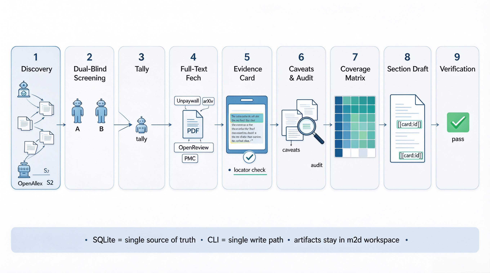

# mine2digest

批量半自动文献流水线：检索 → 双 agent 双盲筛选 → 取全文 → 证据卡 → 反证/审计 → 覆盖与导出 → 逐节草稿。
以 **agent skill + CLI** 的形式提供，产物全部落在当前目录的 `m2d/` 工作区。



## 使用

要求 Python 3.11+。

```bash
pip install -e ".[all]"      # 安装 CLI 与全部依赖
mine2digest init             # 在当前目录创建 m2d/ 工作区
```

在支持 skill 的宿主（如 opencode）里直接提出需求即可，skill 会自动加载；也可手动跑：

```bash
# 1. 发现
python scripts/openalex_seed.py --query "CLIP multimodal generalization" \
  --limit 50 --out tmp/seeds.jsonl
mine2digest add-candidates --source openalex --file tmp/seeds.jsonl

# 2. 双 agent 筛选（A/B 各用独立上下文投票）
mine2digest next-candidates --agent-id A --limit 50
mine2digest next-candidates --agent-id B --limit 50
mine2digest submit-vote --agent-id A --file tmp/votes_A.json
mine2digest submit-vote --agent-id B --file tmp/votes_B.json
mine2digest tally-votes

# 3. 取全文
python scripts/fetch_worker.py --limit 5 --rounds 3 --worker w1

# 4. 阅读建卡
mine2digest next-reading --limit 5 --out-dir tmp
mine2digest add-card --file tmp/cards_<paper_id>.json

# 5. 覆盖、导出、草稿
mine2digest coverage
mine2digest export
mine2digest draft --section intro
mine2digest verify --file drafts/intro.md
```

全局安装 skill：

```bash
python scripts/install_skill.py            # -> ~/.config/opencode/skills/mine2digest/
python scripts/install_skill.py --check
```

密钥（`UNPAYWALL_EMAIL` 等）放在 skill 目录的 `.env`，CLI 自动加载，勿写入工作区。

完整流程与命令契约见 [`SKILL.md`](.opencode/skills/mine2digest/SKILL.md) 和 [`docs/tools.json`](docs/tools.json)。

## 仓库目录

```text
.
├── .opencode/skills/mine2digest/
│   ├── SKILL.md              # 完整工作流（宿主自动加载）
│   └── .env.example          # 密钥模板
├── SKILL.md                  # 可移植入口
├── config/                   # labels.yaml + 各角色提示词
├── docs/tools.json           # 机器可读命令 schema
├── scripts/                  # 发现 / 取全文 / 安装 / live 烟测
├── src/mine2digest/
│   ├── cli.py                # CLI 入口（统一 JSON 契约）
│   ├── commands/             # 各阶段命令实现
│   ├── fetchers/             # unpaywall / arxiv / openreview / pmc
│   ├── pdf/                  # 抽取 / locator / 页预选 / 渲染
│   └── data/                 # 内置 labels 与提示词
└── tests/                    # 单元 / 契约 / 一致性 / 可选集成
```

工作区 `m2d/`（运行后生成）：`config/` 研究 brief、`db/` SQLite、`papers/` 全文、`exports/`、`drafts/`、`outputs/`、`logs/`、`tmp/`。

## 测试

```bash
pytest -q                 # 全部（live 默认 skip）
pytest -m integration     # 真实 agent 冒烟
```
